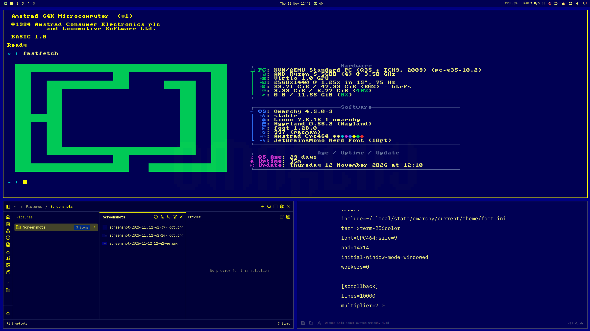

# Amstrad CPC 464 Theme for Omarchy 4.5+

An authentic 8-bit retro theme for **Omarchy 4.5 (Quattro)** inspired by the iconic **1984 Amstrad CPC 464** microcomputer (`CTM644` Color CRT monitor, Locomotive BASIC 1.0, and the classic colored mechanical keycaps).

### 🖥️ Workspace & Terminal (`CPC464` Font + Gate Array Palette)


### 🎨 Clean Desktop (`OMARCHY` CPC 464 Wallpaper)


---

## ✨ Features

* **Authentic Gate Array Color Palette (`colors.toml`):**
  * Royal Blue CRT screen backdrop (`#000052`) tuned for comfortable daily coding and reading.
  * Locomotive BASIC Ink 1 Bright Yellow (`#ffff00`) accents and block cursor, paired with warm cream-yellow (`#f2f27a`) primary text.
  * ANSI colors mapped directly to the Amstrad Gate Array hardware pens and classic **Red** (`ESC`/`STOP`), **Green** (`SHIFT`/`COPY`), and **Blue** (`ENTER`/Numpad) keycaps.
  * 45-degree **Red → Green → Blue** active window border gradient in Hyprland.
* **Sharp 8-Bit UI Geometry (`shell.controls.toml`):** Zero corner radius (`corner-radius = 0`) across Quickshell surfaces with high-contrast red/yellow interactive highlights.
* **Multi-Terminal Integration (Foot, Ghostty, Alacritty & Kitty — Active Only When Selected):**
  * Automatically switches the terminal font to the pixel-accurate **CPC464** font (`size=10`) across **Foot**, **Ghostty**, **Alacritty**, and **Kitty** when this theme is active, restoring your default font when you switch to any other theme.
  * Displays the classic **1984 Locomotive BASIC 1.0 `Ready`** startup banner when opening any of those four terminals.
  * Includes a custom `clear` override that preserves the BASIC header and a classic `cls` command to wipe the screen completely blank.
  * Automatically opens a terminal window to the `Ready` prompt on boot/login **only** when the Amstrad CPC 464 theme is active.
* **7 Curated Wallpapers (`backgrounds/`):** Cycle through custom Omarchy-styled Amstrad graphics, hardware photography, and Locomotive BASIC backdrops using `Super + Ctrl + Space`.

---

## 🚀 Installation

### One-Line Install (Theme + Font + BASIC Banner + Boot Terminal)

Run the following command in your terminal to install the theme via Omarchy and configure the automatic theme-switching hooks:

```bash
omarchy theme install https://github.com/DavidSom-IT/amstrad-cpc464 && ~/.config/omarchy/themes/amstrad-cpc464/install.sh
```

### Theme-Only Install (Colors & Wallpapers Only)

If you only want the color scheme and wallpapers without the terminal font hook, startup banner, or boot terminal:

```bash
omarchy theme install https://github.com/DavidSom-IT/amstrad-cpc464
```

### Uninstalling the Extras

To remove the `~/.bashrc` banner link, the font hook, and the Hyprland autostart check while keeping your personal configs intact:

```bash
~/.config/omarchy/themes/amstrad-cpc464/install.sh --uninstall
```

---

## 🖥️ Terminal Commands Included

When the **Amstrad CPC 464** theme is active in **Foot**, **Ghostty**, **Alacritty**, or **Kitty**:
* `clear` — Clears the terminal and reprints the `Amstrad 64K Microcomputer (v1) / BASIC 1.0 / Ready` header.
* `cls` — Clears the terminal completely without reprinting the header (classic Locomotive BASIC syntax).

> **Note for Ghostty, Alacritty & Kitty users:** If you have manually defined a `font` setting *below* Omarchy's theme `include`/`import` line in your personal terminal config file, your personal font rule will take precedence over the theme's `CPC464` font.

---

## 📁 Repository Structure

```text
amstrad-cpc464/
├── backgrounds/           # 7 Amstrad CPC 464 & Omarchy-styled wallpapers
├── extras/
│   ├── CPC464.ttf         # Amstrad CPC 464 pixel font
│   └── amstrad-bashrc.sh  # Locomotive BASIC 1.0 banner & clear/cls helpers
├── screenshots/           # Preview screenshots for README
├── colors.toml            # Gate Array & CTM644 CRT color definitions
├── foot.ini               # Terminal colors & CPC464 font configuration
├── icons.theme            # Yaru-yellow icon theme definition
├── install.sh             # Automated setup for font, hooks, and autostart
├── README.md              # Documentation & credits
└── shell.controls.toml    # Sharp 0px corner radius & retro control colors
```

---

## 🙏 Credits & Attribution

* **Theme Design, Integration & Custom Wallpapers:**
  * Created by **David Som ([@DavidSom-IT](https://github.com/DavidSom-IT))**.
  * Wallpapers `01` and `07` were originally generated via the terminal using **ImageMagick** and the Omarchy font.
* **Font:**
  * **CPC464 Font** by **Dmian** — sourced from [codeberg.org/Dmian/font-cpc464](https://codeberg.org/Dmian/font-cpc464), reproducing the original 1984 Amstrad CPC 464 ROM character set.
* **Community Wallpapers (via WallpaperCave):**
  * `02-amstrad-closeup-high.png` — Uploaded by [lucrece143](https://wallpapercave.com/u/lucrece143)
  * `03-amstrad-cpc464-color-closeup-high.png` — Uploaded by [freibeuter](https://wallpapercave.com/u/freibeuter)
  * `04-amstrad-logo-high.png` — Uploaded by [user](https://wallpapercave.com/u/user)
  * `05-locomotive-basic-ready.png` — Uploaded by [hrn78](https://wallpapercave.com/u/hrn78)
  * `06-locomotive-basic-high.png` — Uploaded by [jessica_53429](https://wallpapercave.com/u/jessica_53429)
* **Trademarks:**
  * *Amstrad*, *CPC 464*, and *Locomotive BASIC* are historical trademarks of Amstrad Consumer Electronics plc and Locomotive Software Ltd.

> *Disclaimer: Hardware photography and the ROM-derived font remain the property of their respective creators. This is a free, non-commercial community tribute theme. If you are the creator of an asset included here and would like it credited differently or removed, please open an issue.*
