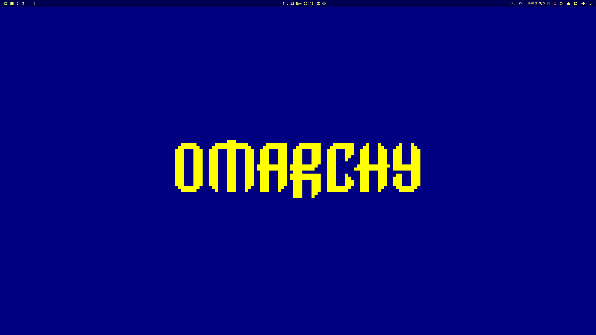

# Amstrad CPC 464 Theme for Omarchy 4.5+

An authentic 8-bit retro theme for **Omarchy 4.5 (Quattro)** inspired by the iconic **1984 Amstrad CPC 464** microcomputer (`CTM644` Color CRT monitor, Locomotive BASIC 1.0, and the classic colored mechanical keycaps).

### 🖥️ Workspace & Terminal (`CPC464` Font + Gate Array Palette)


### 🎨 Clean Desktop (`OMARCHY` CPC 464 Wallpaper)


---

## ✨ Features

* **Authentic Gate Array Color Palette (`colors.toml`):**
  * Royal Blue CRT screen backdrop (`#000052`) tuned for comfortable daily coding and reading.
  * Locomotive BASIC Ink 1 Bright Yellow (`#ffff00`) accents and block cursor, paired with warm cream-yellow (`#f2f27a`) primary text.
  * ANSI colors mapped directly to the Amstrad Gate Array hardware pens and classic **Red** (`ESC`/`STOP`), **Green** (`SHIFT`/`COPY`), and **Blue** (`ENTER`/Numpad) keycaps.
  * 45-degree **Red → Green → Blue** active window border gradient in Hyprland.
* **Sharp 8-Bit UI Geometry (`shell.controls.toml`):** Zero corner radius (`corner-radius = 0`) across Quickshell surfaces with high-contrast red/yellow interactive highlights.
* **Native Multi-Terminal Color Generation:** Automatically styles **Foot**, **Ghostty**, **Alacritty**, and **Kitty** directly from `colors.toml` when the theme is selected.
- **Optional Pixel Font Included (`extras/CPC464.ttf`):** Ships the pixel-accurate 1984 **CPC464** TrueType font if you want to pair the color scheme with authentic 8-bit typography.
* **7 Curated Wallpapers (`backgrounds/`):** Cycle through custom Omarchy-styled Amstrad graphics, hardware photography, and Locomotive BASIC backdrops using `Super + Ctrl + Space`.

---

## 🚀 Installation

### Install the theme directly via Omarchy

```bash
omarchy theme install https://github.com/DavidSom-IT/amstrad-cpc464
```

### Optional: Installing the `CPC464` Pixel Font
If you would like to use the included 1984 Amstrad pixel font in your terminal:

```bash
mkdir -p ~/.local/share/fonts
cp ~/.config/omarchy/themes/amstrad-cpc464/extras/CPC464.ttf ~/.local/share/fonts/
fc-cache -f
```
You can then select `CPC464` via `omarchy font set "CPC464"` or in your terminal configuration.

---

## 📁 Repository Structure

```text
amstrad-cpc464/
├── backgrounds/           # 7 Amstrad CPC 464 & Omarchy-styled wallpapers
├── extras/
│   └── CPC464.ttf         # Amstrad CPC 464 pixel font
├── screenshots/           # Preview screenshots for README
├── colors.toml            # Gate Array & CTM644 CRT color definitions
├── icons.theme            # Yaru-yellow icon theme definition
├── preview.png            # Theme picker preview screenshot
├── README.md              # Documentation & credits
└── shell.controls.toml    # Sharp 0px corner radius & retro control colors
```

---

## 🙏 Credits & Attribution

* **Theme Design, Integration & Custom Wallpapers:**
  * Created by **David Som ([@DavidSom-IT](https://github.com/DavidSom-IT))**.
  * Wallpapers `01` and `07` were originally generated via the terminal using **ImageMagick** and the Omarchy font.
* **Font:**
  * **CPC464 Font** by **Dmian** — sourced from [codeberg.org/Dmian/font-cpc464](https://codeberg.org/Dmian/font-cpc464), reproducing the original 1984 Amstrad CPC 464 ROM character set.
* **Community Wallpapers (via WallpaperCave):**
  * `02-amstrad-closeup-high.webp` — Uploaded by [lucrece143](https://wallpapercave.com/u/lucrece143)
  * `03-amstrad-cpc464-color-closeup-high.webp` — Uploaded by [freibeuter](https://wallpapercave.com/u/freibeuter)
  * `04-amstrad-logo-high.png` — Uploaded by [user](https://wallpapercave.com/u/user)
  * `05-locomotive-basic-ready.png` — Uploaded by [hrn78](https://wallpapercave.com/u/hrn78)
  * `06-locomotive-basic-high.png` — Uploaded by [jessica_53429](https://wallpapercave.com/u/jessica_53429)
* **Trademarks:**
  * *Amstrad*, *CPC 464*, and *Locomotive BASIC* are historical trademarks of Amstrad Consumer Electronics plc and Locomotive Software Ltd.

> *Disclaimer: Hardware photography and the ROM-derived font remain the property of their respective creators. This is a free, non-commercial community tribute theme. If you are the creator of an asset included here and would like it credited differently or removed, please open an issue.*
